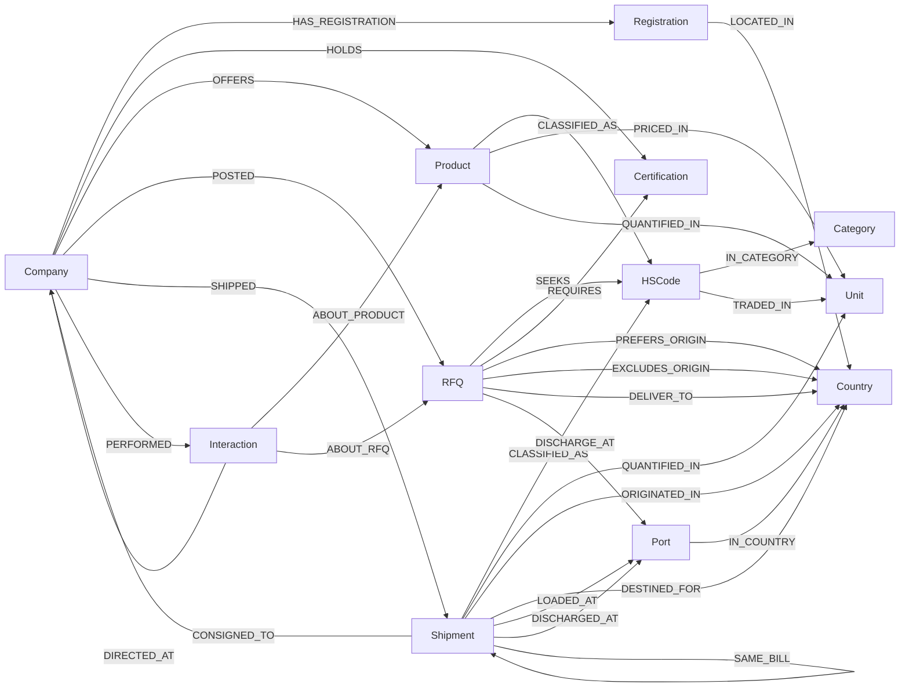

# Ontology Design

- A business query starts at a resolved `Company`, never at a raw registration or a raw name string.
- Source rows stay intact. Cleaning writes a link. It does not overwrite the raw value.

## Shipment is a node

A shipment is one customs record: a bill of lading, a date, a value, a quantity, an incoterm, a goods description, and an HS code. It also connects six parties at once: shipper, consignee, origin country, destination country, port of loading, and port of discharge. Origin is not the shipper’s country. In this file the two differ on purpose.

An edge only joins two nodes. Modeling the record as `(:Company)-[:SHIPPED_TO {value, hs, date, ...}]->(:Company)` would bury the other four endpoints inside relationship properties. Neo4j cannot start a traversal from a relationship, so “shipments of HS 870830 that did not originate in China, discharged at Jebel Ali” becomes a scan of every trade edge. Price comparison and the 60% customer-concentration query have the same shape: filter shipments, then aggregate. Those filters want a node with indexes on `shipment_date`, `value_usd`, and `bill_of_lading`.

The cost of a node is real. This extract has 50,173 shipment rows, and the design target is tens of millions. Each shipment adds a node plus about eight relationships, and the common seller-to-buyer question takes two hops instead of one. That cost is accepted because the edge model cannot represent the record without losing the paths Task 3 and Task 5 actually walk.

What we do not do is also store a summary edge such as `EXPORTS_TO` or `INTERACTED_WITH`. Those are derivable, and a second copy drifts as soon as a daily load adds shipments. Aggregates are queries over `Shipment` and `Interaction`. If a specific query is too slow at scale, a summary edge can be added later as a rebuildable projection, clearly marked derived, never as the source of truth.

Duplicate bills of lading stay as separate `Shipment` nodes, because each source row has its own `shipment_id` and the file does not say which copy is wrong. Shipments that share a bill of lading are linked with `SAME_BILL`. Value, quantity, and concentration metrics count distinct bills, not raw rows.

## Node types
### Company

The resolved party.

| Property | Why it is here |
|---|---|
| `entity_id` | Stable id (`ENT-*`), assigned at resolution. This is the id queries use. |
| `canonical_name` | Display name, chosen from the richest registration or the most frequent shipment spelling. |
| `on_platform` | False for shipment-only parties. |
| `party_kind` | `company`, `bank`, `forwarder`, `to_order`, `unknown`. |
| `roles` | Normalized roles, union across registrations. |
| `activity_class` | Derived. `manufacturer`, `trader`, `mixed`, `unknown`. |
| `year_established` | Best non-empty value across registrations. |
| `employee_range` | Best non-empty value. Blank on 1,195 of 5,020 rows, so it may be null. |

Contacts, address, city, the raw type string, and `registered_on` live on `Registration`. They conflict across duplicates and are entity-resolution evidence, not query keys.

### Registration

One row of `companies.csv`.

| Property | Source |
|---|---|
| `company_id` | `CMP-*`. Primary key of this node. |
| `raw_name`, `raw_country`, `city`, `address` | As entered. City keeps old and new names. |
| `website`, `email`, `phone` | Raw and a normalized form, used for matching. |
| `declared_type` | Raw `company_type`. |
| `about` | Profile text. Often blank. |
| `registered_on` | Platform creation date. |

### Product

One seller listing (`PRD-*`). The listing belongs to the resolved company. `registration_id` records which `CMP-*` row created it, so a merge does not hide the source.

| Property | Notes |
|---|---|
| `product_id` | Source id. |
| `registration_id` | The `CMP-*` that listed it. |
| `title`, `description` | Free text. No HS code in the source. |
| `moq`, `price_usd_min`, `price_usd_max` | Indicative listing terms. Not a traded price. |
| `listed_on` | Listing date. |
| `hs_status` | `mapped` or `unmappable`. Listings too vague to classify get `unmappable` and no HS link. |

Quantity and price units are not stored as strings on the product. They are `QUANTIFIED_IN` and `PRICED_IN` links to `Unit`, after alias normalization (`KGS`, `KILOGRAMS`, `KGM` → `KG`).

### HSCode

One row of `hs_codes.csv`. The key is the 6-digit code. There are 68 of them. Shipments arrive as 4, 5, 6, or 8 digits, sometimes blank (2,003 of 50,173) or oddly formatted. The raw code stays on the shipment. `CLASSIFIED_AS` is created only when the value resolves to one of these 68 codes: an 8-digit code keeps its first 6 digits if that code exists; a 4-digit, 5-digit, blank, or unknown code gets no link. Guessing a 4-digit heading onto one of several 6-digit codes would invent a classification.

| Property | Notes |
|---|---|
| `hs_code` | 6-digit string. |
| `description` | Reference description. |
| `chapter` | First 2 digits, stored for grouping. Not a separate node. The category list is the grouping Task 3b asks for. |

`TRADED_IN` points at the reference `typical_unit` for that code. Price comparisons convert shipment quantities into this unit.

### Category

The `category` column on `hs_codes.csv`. Eleven values, including `Agriculture & Food` and `Automotive`. Task 3b filters on this, so it is a node rather than a string on the HS code.

| Property | Notes |
|---|---|
| `name` | Exact category string from the reference file. |

### Country

One real country. The files use 70 spellings (`UAE`, `U.A.E.`, `Emirates`, `KSA`, `Turkiye`, `Türkiye`, `PRC`, `CHN`). The node stores one canonical name and the alias list. Raw spellings stay on the registration or shipment that used them.

| Property | Notes |
|---|---|
| `iso2` | ISO 3166-1 alpha-2. Primary key. |
| `iso3` | Alpha-3, because several source spellings are alpha-3 (`IND`, `DEU`, `KEN`). |
| `name` | Canonical English name. |
| `aliases` | Observed spellings that map here. |

“Suppliers from India” can mean the company’s registered country or the origin of the goods. Both paths exist. `Registration` `LOCATED_IN` `Country` is where the account is registered. `Shipment` `ORIGINATED_IN` `Country` is where the goods were produced. Search states which one it used.

### Port

One port of loading or discharge. The file mixes names, aliases, and UN/LOCODEs (156 distinct strings). RFQ text names ports too (`Alexandria Port`, `Jeddah`, `Hamburg`).

| Property | Notes |
|---|---|
| `port_id` | UN/LOCODE when known, otherwise a stable slug. |
| `name` | Canonical name. |
| `unlocode` | Null when the source never gives one. |
| `aliases` | `Khalid Port`, locode variants, and similar. |

### Unit

Canonical unit of quantity. Listing prices and shipment values are only comparable after this normalization, which Task 5 requires.

| Property | Notes |
|---|---|
| `code` | `KG`, `MT`, `PCS`, `SQM`, `G`, `CT`, `PAIRS`. |
| `aliases` | `KILOGRAMS`, `KGS`, `KGM`, `TONS`, `M/T`, `PIECES`, `M2`, `CARAT`, and the rest observed in the files. |
| `dimension` | `mass`, `count`, or `area`. Conversion across dimensions is refused, not guessed. |

### Certification

One canonical certificate. The same certificate is written many ways (`ISO 9001`, `ISO-9001`, `iso9001`, `ISO 9001:2015`). RFQ matching and the sentence “Holds IATF 16949” both need one node per real certificate.

| Property | Notes |
|---|---|
| `code` | Stable id, e.g. `ISO_9001`, `IATF_16949`, `HALAL`. |
| `name` | Display name. |
| `aliases` | Spellings that map here. |
| `family` | `quality`, `food_safety`, `automotive`, `regulatory`, `social`, `organic`, `other`. |

### Shipment

One source row from `shipments.csv`.

| Property | Notes |
|---|---|
| `shipment_id` | Source id. |
| `bill_of_lading` | Carrier B/L. Indexed. Shared by rows linked with `SAME_BILL`. |
| `shipment_date` | Date. Indexed. |
| `goods_description` | Free text, as filed. |
| `hs_raw` | Digits as filed, before resolution. Empty if blank. |
| `quantity`, `quantity_unit_raw` | As filed. The canonical unit is the `QUANTIFIED_IN` link. |
| `quantity_canonical` | Quantity converted into the linked unit. Null if the unit is unknown. |
| `value_usd` | Declared value. Null when the source is blank or zero (1,247 rows), so those rows cannot move a price or a concentration share. |
| `incoterm` | `FOB`, `CIF`, `CFR`, `DAP`, `EXW`, `FCA`. |
| `shipper_name_raw`, `consignee_name_raw` | Names as filed, including the address text that is sometimes concatenated into the name. |

### RFQ

One buyer request from `rfqs.json`. The raw text is kept verbatim. Parsed fields are links, so a recommendation can cite a path instead of a paraphrase.

| Property | Notes |
|---|---|
| `rfq_id` | Source id. |
| `text` | Raw buyer text. |
| `created_at`, `status` | `open`, `expired`, `awarded`, `closed`. |
| `product_phrase` | Product span extracted from the text. |
| `quantity` | Parsed amount. Null if absent. |
| `incoterm` | Parsed term. Null if absent. |
| `target_price_usd` | Parsed target, if the buyer stated one. |
| `parse_notes` | What was extracted and what was left unresolved. |

### Interaction

One platform event. It is a node because an event ties an actor, a target, a timestamp, and optionally a product or an RFQ. A single company-to-company edge cannot point at the listing that was viewed or the RFQ that was answered, and the scorecard needs the mix of views, chats, and quotations (26,041 events, eight event types).

| Property | Notes |
|---|---|
| `event_id` | Source id. |
| `event_type` | `profile_view`, `product_view`, `chat_request`, `chat_accepted`, `chat_rejected`, `quotation_sent`, `quotation_accepted`, `rfq_response`. |
| `event_time` | Timestamp. |

Responsiveness is computed from these events: accepted chats over chat requests, accepted quotations over quotations sent, and RFQ responses. It is not stored as a second fact.

## Relationship types

Relationships written in **bold** are inferred. They store `method` and `confidence` (0 to 1), plus the raw string they were matched from, so a wrong link can be audited without re-reading the source file. The others are copied from a source foreign key.

| Relationship | From → to | Meaning | Extra properties |
|---|---|---|---|
| `HAS_REGISTRATION` | Company → Registration | This platform row belongs to this resolved company. | `method`, `confidence` |
| `LOCATED_IN` | Registration → Country | Country on the registration, after alias normalization. | `raw_country` |
| `HOLDS` | Company → Certification | Union of certificates parsed from every registration. | `raw_text`, `registration_id` |
| `OFFERS` | Company → Product | The resolved company publishes this listing. | |
| **`CLASSIFIED_AS`** | Product or Shipment → HSCode | Resolved 6-digit code. Absent when unmappable or unresolved. | `method`, `confidence`, and on shipments `hs_raw` |
| `IN_CATEGORY` | HSCode → Category | Reference category. | |
| `TRADED_IN` | HSCode → Unit | Reference typical unit. | |
| `PRICED_IN` | Product → Unit | Unit of `price_usd_min` / `price_usd_max`. | |
| `QUANTIFIED_IN` | Product or Shipment → Unit | Canonical unit of the stated quantity. | `raw_unit` |
| `SHIPPED` | Company → Shipment | This party is the shipper. | `raw_name`, `raw_country`, `method`, `confidence` |
| `CONSIGNED_TO` | Shipment → Company | This party is the consignee. | `raw_name`, `raw_country`, `method`, `confidence` |
| `ORIGINATED_IN` | Shipment → Country | Where the goods were produced. | `raw_country` |
| `DESTINED_FOR` | Shipment → Country | Destination country of the goods. | `raw_country` |
| `LOADED_AT` | Shipment → Port | Port of loading. | `raw_port` |
| `DISCHARGED_AT` | Shipment → Port | Port of discharge. | `raw_port` |
| `IN_COUNTRY` | Port → Country | Country of the port. | |
| `SAME_BILL` | Shipment → Shipment | Two rows share a bill of lading. One edge per pair, lower id first. | `bill_of_lading` |
| `POSTED` | Company → RFQ | The buyer who wrote the request. Source `buyer_company_id`, then resolved to the company. | |
| **`SEEKS_CATEGORY`** | RFQ → Category | Coarse product intent, extracted before any HS code. | `method`, `confidence`, `raw_text` |
| **`SEEKS`** | RFQ → HSCode | 6-digit code, chosen only from inside the sought category. Absent when the text does not support one code. | `method`, `confidence` |
| **`REQUIRES`** | RFQ → Certification | Certificate the buyer demanded. | `raw_text` |
| **`PREFERS_ORIGIN`** | RFQ → Country | Origin the buyer asked for. | `raw_text` |
| **`EXCLUDES_ORIGIN`** | RFQ → Country | Origin the buyer ruled out. | `raw_text` |
| **`DELIVER_TO`** | RFQ → Country | Destination country parsed from the request. | `raw_text` |
| **`DISCHARGE_AT`** | RFQ → Port | Delivery port parsed from the request. | `raw_text` |
| `PERFORMED` | Company → Interaction | The company that did the action. | |
| `DIRECTED_AT` | Interaction → Company | The company the action was aimed at. | |
| `ABOUT_PRODUCT` | Interaction → Product | Set for `product_view`. | |
| `ABOUT_RFQ` | Interaction → RFQ | Set for `rfq_response`. | |

`SHIPPED` and `CONSIGNED_TO` point at a `Company` of any `party_kind`. Queries that recommend a supplier or a buyer add `party_kind = company`. The lane itself remains visible for price and volume stats.

`SEEKS_CATEGORY` is an independent extraction from the RFQ text, not a copy of the HS code’s category. Parsing goes coarse to fine. The text is matched to one of the eleven categories first. A 6-digit code is proposed only from the HS codes `IN_CATEGORY` that category, and `SEEKS` is written only when one code is confident enough to stand on. If the text supports a category but not a single code, the RFQ has `SEEKS_CATEGORY` and no `SEEKS`. If a classifier returns an HS code outside the extracted category, the category link is kept, the HS link is not written, and the disagreement goes in `parse_notes`. When the text never names a category but an HS code is still confident, `SEEKS_CATEGORY` is written with `method = inherited_from_hs` so the fallback path exists. A text extraction uses `method = text`.

An HS suggestion that lands outside the winning category is dropped. The category link stays, and the disagreement is recorded in `parse_notes`. A model may propose the span or a category from the closed list of eleven. The vote above is what creates the relationship. A proposal that matches no description in that category is rejected rather than stored.

## Schema

