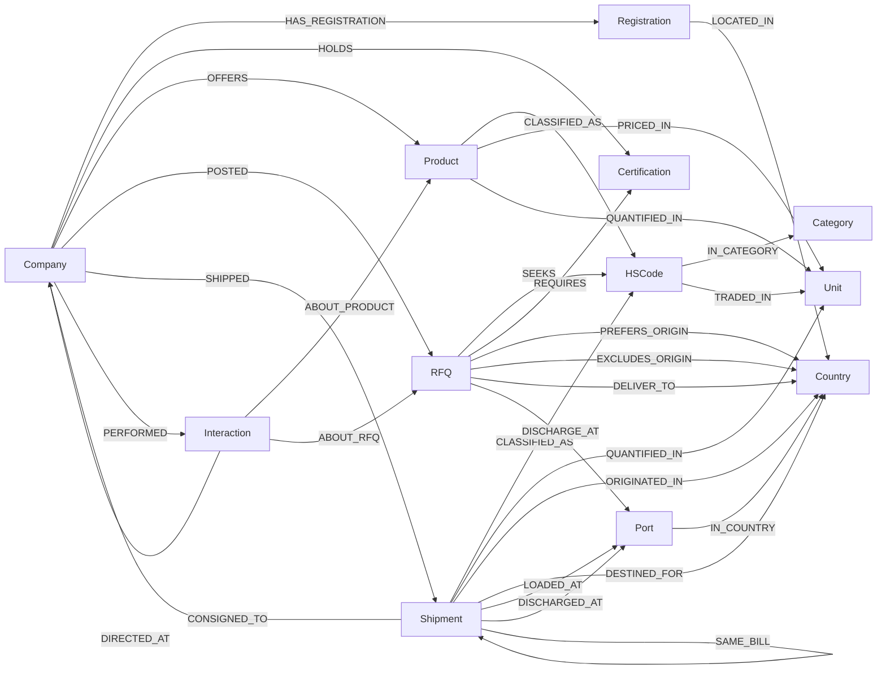

# ONTOLOGY DESIGN

- A business query starts at a resolved `Company`, never at a raw registration or a raw name string.
- Source rows stay intact. Cleaning writes a link. It does not overwrite the raw value.


## Shipment is a node

A shipment is one customs record: a bill of lading, a date, a value, a quantity, an incoterm, a goods description, and an HS code. It also connects six parties at once: shipper, consignee, origin country, destination country, port of loading, and port of discharge. Origin is not the shipper’s country. In this file the two differ on purpose.

An edge only joins two nodes. Modeling the record as `(:Company)-[:SHIPPED_TO {value, hs, date, ...}]->(:Company)` would bury the other four endpoints inside relationship properties. Neo4j cannot start a traversal from a relationship, so “shipments of HS 870830 that did not originate in China, discharged at Jebel Ali” becomes a scan of every trade edge. Price comparison and the 60% customer-concentration query have the same shape: filter shipments, then aggregate. Those filters want a node with indexes on `shipment_date`, `value_usd`, and `bill_of_lading`.

The cost of a node is real. This extract has 50,173 shipment rows, and the design target is tens of millions. Each shipment adds a node plus about eight relationships, and the common seller-to-buyer question takes two hops instead of one. That cost is accepted because the edge model cannot represent the record without losing the paths Task 3 and Task 5 actually walk.

What we do not do is also store a summary edge such as `EXPORTS_TO` or `INTERACTED_WITH`. Those are derivable, and a second copy drifts as soon as a daily load adds shipments. Aggregates are queries over `Shipment` and `Interaction`. If a specific query is too slow at scale, a summary edge can be added later as a rebuildable projection, clearly marked derived, never as the source of truth.

Duplicate bills of lading stay as separate `Shipment` nodes, because each source row has its own `shipment_id` and the file does not say which copy is wrong. Shipments that share a bill of lading are linked with `SAME_BILL`. Value, quantity, and concentration metrics count distinct bills, not raw rows.


## Node types
### Company

The resolved party.

| Property | Why it is here |
|---|---|
| `entity_id` | Stable id (`ENT-*`), assigned at resolution. This is the id queries use. |
| `canonical_name` | Display name, chosen from the richest registration or the most frequent shipment spelling. |
| `on_platform` | False for shipment-only parties. |
| `party_kind` | `company`, `bank`, `forwarder`, `to_order`, `unknown`. |
| `roles` | Normalized roles, union across registrations. |
| `activity_class` | Derived. `manufacturer`, `trader`, `mixed`, `unknown`. |
| `year_established` | Best non-empty value across registrations. |
| `employee_range` | Best non-empty value. Blank on 1,195 of 5,020 rows, so it may be null. |

Contacts, address, city, the raw type string, and `registered_on` live on `Registration`. They conflict across duplicates and are entity-resolution evidence, not query keys.

### Registration

One row of `companies.csv`.

| Property | Source |
|---|---|
| `company_id` | `CMP-*`. Primary key of this node. |
| `raw_name`, `raw_country`, `city`, `address` | As entered. City keeps old and new names. |
| `website`, `email`, `phone` | Raw and a normalized form, used for matching. |
| `declared_type` | Raw `company_type`. |
| `about` | Profile text. Often blank. |
| `registered_on` | Platform creation date. |

### Product

One seller listing (`PRD-*`). The listing belongs to the resolved company. `registration_id` records which `CMP-*` row created it, so a merge does not hide the source.

| Property | Notes |
|---|---|
| `product_id` | Source id. |
| `registration_id` | The `CMP-*` that listed it. |
| `title`, `description` | Free text. No HS code in the source. |
| `moq`, `price_usd_min`, `price_usd_max` | Indicative listing terms. Not a traded price. |
| `listed_on` | Listing date. |
| `hs_status` | `mapped` or `unmappable`. Listings too vague to classify get `unmappable` and no HS link. |

Quantity and price units are not stored as strings on the product. They are `QUANTIFIED_IN` and `PRICED_IN` links to `Unit`, after alias normalization (`KGS`, `KILOGRAMS`, `KGM` → `KG`).

### HSCode

One row of `hs_codes.csv`. The key is the 6-digit code. There are 68 of them. Shipments arrive as 4, 5, 6, or 8 digits, sometimes blank (2,003 of 50,173) or oddly formatted. The raw code stays on the shipment. `CLASSIFIED_AS` is created only when the value resolves to one of these 68 codes: an 8-digit code keeps its first 6 digits if that code exists; a 4-digit, 5-digit, blank, or unknown code gets no link. Guessing a 4-digit heading onto one of several 6-digit codes would invent a classification.

| Property | Notes |
|---|---|
| `hs_code` | 6-digit string. |
| `description` | Reference description. |
| `chapter` | First 2 digits, stored for grouping. Not a separate node. The category list is the grouping Task 3b asks for. |

`TRADED_IN` points at the reference `typical_unit` for that code. Price comparisons convert shipment quantities into this unit.

### Category

The `category` column on `hs_codes.csv`. Eleven values, including `Agriculture & Food` and `Automotive`. Task 3b filters on this, so it is a node rather than a string on the HS code.

| Property | Notes |
|---|---|
| `name` | Exact category string from the reference file. |

### Country

One real country. The files use 70 spellings (`UAE`, `U.A.E.`, `Emirates`, `KSA`, `Turkiye`, `Türkiye`, `PRC`, `CHN`). The node stores one canonical name and the alias list. Raw spellings stay on the registration or shipment that used them.

| Property | Notes |
|---|---|
| `iso2` | ISO 3166-1 alpha-2. Primary key. |
| `iso3` | Alpha-3, because several source spellings are alpha-3 (`IND`, `DEU`, `KEN`). |
| `name` | Canonical English name. |
| `aliases` | Observed spellings that map here. |

“Suppliers from India” can mean the company’s registered country or the origin of the goods. Both paths exist. `Registration` `LOCATED_IN` `Country` is where the account is registered. `Shipment` `ORIGINATED_IN` `Country` is where the goods were produced. Search states which one it used.

### Port

One port of loading or discharge. The file mixes names, aliases, and UN/LOCODEs (156 distinct strings). RFQ text names ports too (`Alexandria Port`, `Jeddah`, `Hamburg`).

| Property | Notes |
|---|---|
| `port_id` | UN/LOCODE when known, otherwise a stable slug. |
| `name` | Canonical name. |
| `unlocode` | Null when the source never gives one. |
| `aliases` | `Khalid Port`, locode variants, and similar. |

### Unit

Canonical unit of quantity. Listing prices and shipment values are only comparable after this normalization, which Task 5 requires.

| Property | Notes |
|---|---|
| `code` | `KG`, `MT`, `PCS`, `SQM`, `G`, `CT`, `PAIRS`. |
| `aliases` | `KILOGRAMS`, `KGS`, `KGM`, `TONS`, `M/T`, `PIECES`, `M2`, `CARAT`, and the rest observed in the files. |
| `dimension` | `mass`, `count`, or `area`. Conversion across dimensions is refused, not guessed. |

### Certification

One canonical certificate. The same certificate is written many ways (`ISO 9001`, `ISO-9001`, `iso9001`, `ISO 9001:2015`). RFQ matching and the sentence “Holds IATF 16949” both need one node per real certificate.

| Property | Notes |
|---|---|
| `code` | Stable id, e.g. `ISO_9001`, `IATF_16949`, `HALAL`. |
| `name` | Display name. |
| `aliases` | Spellings that map here. |
| `family` | `quality`, `food_safety`, `automotive`, `regulatory`, `social`, `organic`, `other`. |

### Shipment

One source row from `shipments.csv`.

| Property | Notes |
|---|---|
| `shipment_id` | Source id. |
| `bill_of_lading` | Carrier B/L. Indexed. Shared by rows linked with `SAME_BILL`. |
| `shipment_date` | Date. Indexed. |
| `goods_description` | Free text, as filed. |
| `hs_raw` | Digits as filed, before resolution. Empty if blank. |
| `quantity`, `quantity_unit_raw` | As filed. The canonical unit is the `QUANTIFIED_IN` link. |
| `quantity_canonical` | Quantity converted into the linked unit. Null if the unit is unknown. |
| `value_usd` | Declared value. Null when the source is blank or zero (1,247 rows), so those rows cannot move a price or a concentration share. |
| `incoterm` | `FOB`, `CIF`, `CFR`, `DAP`, `EXW`, `FCA`. |
| `shipper_name_raw`, `consignee_name_raw` | Names as filed, including the address text that is sometimes concatenated into the name. |

### RFQ

One buyer request from `rfqs.json`. The raw text is kept verbatim. Parsed fields are links, so a recommendation can cite a path instead of a paraphrase.

| Property | Notes |
|---|---|
| `rfq_id` | Source id. |
| `text` | Raw buyer text. |
| `created_at`, `status` | `open`, `expired`, `awarded`, `closed`. |
| `product_phrase` | Product span extracted from the text. |
| `quantity` | Parsed amount. Null if absent. |
| `incoterm` | Parsed term. Null if absent. |
| `target_price_usd` | Parsed target, if the buyer stated one. |
| `parse_notes` | What was extracted and what was left unresolved. |

### Interaction

One platform event. It is a node because an event ties an actor, a target, a timestamp, and optionally a product or an RFQ. A single company-to-company edge cannot point at the listing that was viewed or the RFQ that was answered, and the scorecard needs the mix of views, chats, and quotations (26,041 events, eight event types).

| Property | Notes |
|---|---|
| `event_id` | Source id. |
| `event_type` | `profile_view`, `product_view`, `chat_request`, `chat_accepted`, `chat_rejected`, `quotation_sent`, `quotation_accepted`, `rfq_response`. |
| `event_time` | Timestamp. |

Responsiveness is computed from these events: accepted chats over chat requests, accepted quotations over quotations sent, and RFQ responses. It is not stored as a second fact.

## Relationship types

Relationships written in **bold** are inferred. They store `method` and `confidence` (0 to 1), plus the raw string they were matched from, so a wrong link can be audited without re-reading the source file. The others are copied from a source foreign key.

| Relationship | From → to | Meaning | Extra properties |
|---|---|---|---|
| `HAS_REGISTRATION` | Company → Registration | This platform row belongs to this resolved company. | `method`, `confidence` |
| `LOCATED_IN` | Registration → Country | Country on the registration, after alias normalization. | `raw_country` |
| `HOLDS` | Company → Certification | Union of certificates parsed from every registration. | `raw_text`, `registration_id` |
| `OFFERS` | Company → Product | The resolved company publishes this listing. | |
| **`CLASSIFIED_AS`** | Product or Shipment → HSCode | Resolved 6-digit code. Absent when unmappable or unresolved. | `method`, `confidence`, and on shipments `hs_raw` |
| `IN_CATEGORY` | HSCode → Category | Reference category. | |
| `TRADED_IN` | HSCode → Unit | Reference typical unit. | |
| `PRICED_IN` | Product → Unit | Unit of `price_usd_min` / `price_usd_max`. | |
| `QUANTIFIED_IN` | Product or Shipment → Unit | Canonical unit of the stated quantity. | `raw_unit` |
| `SHIPPED` | Company → Shipment | This party is the shipper. | `raw_name`, `raw_country`, `method`, `confidence` |
| `CONSIGNED_TO` | Shipment → Company | This party is the consignee. | `raw_name`, `raw_country`, `method`, `confidence` |
| `ORIGINATED_IN` | Shipment → Country | Where the goods were produced. | `raw_country` |
| `DESTINED_FOR` | Shipment → Country | Destination country of the goods. | `raw_country` |
| `LOADED_AT` | Shipment → Port | Port of loading. | `raw_port` |
| `DISCHARGED_AT` | Shipment → Port | Port of discharge. | `raw_port` |
| `IN_COUNTRY` | Port → Country | Country of the port. | |
| `SAME_BILL` | Shipment → Shipment | Two rows share a bill of lading. One edge per pair, lower id first. | `bill_of_lading` |
| `POSTED` | Company → RFQ | The buyer who wrote the request. Source `buyer_company_id`, then resolved to the company. | |
| **`SEEKS_CATEGORY`** | RFQ → Category | Coarse product intent, extracted before any HS code. | `method`, `confidence`, `raw_text` |
| **`SEEKS`** | RFQ → HSCode | 6-digit code, chosen only from inside the sought category. Absent when the text does not support one code. | `method`, `confidence` |
| **`REQUIRES`** | RFQ → Certification | Certificate the buyer demanded. | `raw_text` |
| **`PREFERS_ORIGIN`** | RFQ → Country | Origin the buyer asked for. | `raw_text` |
| **`EXCLUDES_ORIGIN`** | RFQ → Country | Origin the buyer ruled out. | `raw_text` |
| **`DELIVER_TO`** | RFQ → Country | Destination country parsed from the request. | `raw_text` |
| **`DISCHARGE_AT`** | RFQ → Port | Delivery port parsed from the request. | `raw_text` |
| `PERFORMED` | Company → Interaction | The company that did the action. | |
| `DIRECTED_AT` | Interaction → Company | The company the action was aimed at. | |
| `ABOUT_PRODUCT` | Interaction → Product | Set for `product_view`. | |
| `ABOUT_RFQ` | Interaction → RFQ | Set for `rfq_response`. | |

`SHIPPED` and `CONSIGNED_TO` point at a `Company` of any `party_kind`. Queries that recommend a supplier or a buyer add `party_kind = company`. The lane itself remains visible for price and volume stats.

`SEEKS_CATEGORY` is an independent extraction from the RFQ text, not a copy of the HS code’s category. Parsing goes coarse to fine. The text is matched to one of the eleven categories first. A 6-digit code is proposed only from the HS codes `IN_CATEGORY` that category, and `SEEKS` is written only when one code is confident enough to stand on. If the text supports a category but not a single code, the RFQ has `SEEKS_CATEGORY` and no `SEEKS`. If a classifier returns an HS code outside the extracted category, the category link is kept, the HS link is not written, and the disagreement goes in `parse_notes`. When the text never names a category but an HS code is still confident, `SEEKS_CATEGORY` is written with `method = inherited_from_hs` so the fallback path exists. A text extraction uses `method = text`.

An HS suggestion that lands outside the winning category is dropped. The category link stays, and the disagreement is recorded in `parse_notes`. A model may propose the span or a category from the closed list of eleven. The vote above is what creates the relationship. A proposal that matches no description in that category is rejected rather than stored.

## Schema




# BUSINESS QUERIES

Four Cypher queries over the loaded graph. The same text is in `src/tradekg/queries.py`. From the repository root:

```bash
PYTHONPATH=src .venv/bin/python -m tradekg.queries
```

That runs each query twice and records the second execution. The time below is Neo4j's own time, from when the server accepted the query to when the last row was produced. The rows and the raw timing are in `reports/task3_results.json`.

Rules shared by all four:

- A buyer or a supplier is a `Company` with `party_kind = company`. Banks, forwarders, and the `To Order` party stay attached to the shipment. They are not customers and they are not suppliers.
- Duplicate bills of lading are one document. The query keeps the shipment node with the lowest `shipment_id` and drops the other filing. Across 501 duplicate pairs, the two rows disagree on the consignee entity 4 times and on value by more than one dollar once. The rest are spelling or rounding.
- Declared value is `value_usd`. Blank and zero values were stored as null and do not enter a sum.
- A query starts at the resolved company, `entity_id`, not at a registration.

## a. Alternative suppliers

For buyer X, find alternative suppliers of HS code Y, excluding origin country Z.

Sample parameters: Lakeshore Motors Inc. (`ENT-01800`), HS `870899` (parts and accessories of motor vehicles, other), origin excluded China (`CN`).

Assumptions:

- Origin is the shipment's `ORIGINATED_IN` country, the place the goods were produced. It is not the supplier's registered country.
- An alternative supplier is on the platform, so the buyer can be introduced to them. The supplier has shipped this HS code on at least one bill whose goods originated outside China.
- A company that already ships this HS code to Lakeshore is a current supplier, so it is left out. Lakeshore already buys `870899` from Qingdao Mingyi Brake System (China), Neumann Autoteile (Germany), and Kingsway Auto Spares (UAE). Qingdao is also removed by the China filter. Neumann and Kingsway are removed because the relationship already exists.
- Rank is the number of distinct non-China bills, then declared value.

```cypher
MATCH (buyer:Company {entity_id: $buyer_id})
MATCH (hs:HSCode {hs_code: $hs_code})
MATCH (excluded:Country {iso2: $exclude_origin})
OPTIONAL MATCH (buyer)<-[:CONSIGNED_TO]-(current_shipment:Shipment)-[:CLASSIFIED_AS]->(hs)
OPTIONAL MATCH (current:Company)-[:SHIPPED]->(current_shipment)
WHERE current.party_kind = 'company'
WITH buyer, hs, excluded,
     [c IN collect(DISTINCT current) WHERE c IS NOT NULL] AS current_suppliers
MATCH (supplier:Company)-[:SHIPPED]->(s:Shipment)-[:CLASSIFIED_AS]->(hs)
MATCH (s)-[:ORIGINATED_IN]->(origin:Country)
WHERE supplier.party_kind = 'company'
  AND supplier.on_platform = true
  AND supplier <> buyer
  AND NOT supplier IN current_suppliers
  AND origin <> excluded
WITH supplier, s.bill_of_lading AS bill, s, origin
ORDER BY s.shipment_id
WITH supplier, bill, head(collect(s)) AS s, head(collect(origin)) AS origin
WITH supplier,
     count(*) AS bills,
     sum(s.value_usd) AS export_value,
     collect(DISTINCT origin.iso2) AS origins
RETURN supplier.entity_id AS entity_id,
       supplier.canonical_name AS supplier,
       supplier.activity_class AS activity,
       bills,
       round(export_value) AS export_value_usd,
       origins
ORDER BY bills DESC, export_value_usd DESC
```

```text
buyer_id: ENT-01800
hs_code: 870899
exclude_origin: CN
```

44 suppliers. Server time 8 ms. The first eight:

| Supplier | Activity | Bills | Export value (USD) | Origins |
|---|---|---:|---:|---|
| Cape Point Trading (Pty) Ltd | mixed | 31 | 3,190,349 | DE, ZA |
| Northstar Motors LLC | mixed | 27 | 2,256,447 | AE, TR, US |
| Marmara Otomotiv San. ve Tic. A.Ş. | manufacturer | 23 | 2,411,950 | TR |
| Malabar Auto Parts Pvt Ltd | manufacturer | 15 | 1,204,915 | IN |
| Shree Mahalaxmi Automotive Pvt Ltd | manufacturer | 14 | 1,066,846 | IN |
| Lanka Star Commodities Trading (Pvt) Ltd | mixed | 13 | 1,479,819 | AE, DE, IN, LK |
| Jai Shiv Shakti Auto Parts Exim | manufacturer | 13 | 1,377,656 | IN |
| Deccan Auto Parts Impex Pvt Ltd | manufacturer | 13 | 1,230,728 | IN |

## b. Buyers with no seller contact

List the buyers that import category A but have never interacted with any seller on the platform.

Sample category: `Agriculture & Food`.

Assumptions:

- Importing the category means the company is the consignee of a shipment whose HS code is `IN_CATEGORY` that category.
- A seller on the platform is an on-platform company that publishes a listing or has shipped a shipment. 2,530 of the 4,208 platform companies meet that test. A pure buyer is not a seller.
- "Never interacted" covers both directions. The buyer has not performed an event aimed at such a seller, and no such seller has performed an event aimed at the buyer. A profile view counts.
- Off-platform consignees have no interaction edges, because every event in the file is between two platform companies. They are in the result. The sample below is the on-platform buyers, who are the ones a seller on the platform can actually contact. The query returns on-platform rows first.

```cypher
MATCH (category:Category {name: $category})<-[:IN_CATEGORY]-(:HSCode)
      <-[:CLASSIFIED_AS]-(s:Shipment)-[:CONSIGNED_TO]->(buyer:Company)
WHERE buyer.party_kind = 'company'
WITH buyer, s.bill_of_lading AS bill, s
ORDER BY s.shipment_id
WITH buyer, bill, head(collect(s)) AS s
WITH buyer, count(*) AS bills, sum(s.value_usd) AS import_value
WHERE NOT EXISTS {
  MATCH (buyer)-[:PERFORMED]->(:Interaction)-[:DIRECTED_AT]->(seller:Company)
  WHERE seller.on_platform = true
    AND seller.party_kind = 'company'
    AND (EXISTS { MATCH (seller)-[:OFFERS]->(:Product) }
         OR EXISTS { MATCH (seller)-[:SHIPPED]->(:Shipment) })
}
AND NOT EXISTS {
  MATCH (seller:Company)-[:PERFORMED]->(:Interaction)-[:DIRECTED_AT]->(buyer)
  WHERE seller.on_platform = true
    AND seller.party_kind = 'company'
    AND (EXISTS { MATCH (seller)-[:OFFERS]->(:Product) }
         OR EXISTS { MATCH (seller)-[:SHIPPED]->(:Shipment) })
}
RETURN buyer.entity_id AS entity_id,
       buyer.canonical_name AS buyer_name,
       buyer.on_platform AS on_platform,
       bills,
       round(import_value) AS import_value_usd
ORDER BY on_platform DESC, import_value_usd DESC
```

```text
category: Agriculture & Food
```

755 buyers: 141 on the platform, 614 off it. Server time 31 ms. The first eight, all on the platform:

| Buyer | Bills | Import value (USD) |
|---|---:|---:|
| Al Ghamdi Provisions Est. | 42 | 76,273,146 |
| Shanghai Longbo Food Import & Export Co., Ltd. | 8 | 41,887,347 |
| Al Shehri Foodstuff Co. | 30 | 41,750,401 |
| Cleopatra Food Distributors for Import & Export | 14 | 40,494,245 |
| Xiamen Shunlong Import & Export Co., Ltd. | 10 | 37,059,918 |
| Kilima Supplies Ltd | 19 | 32,710,885 |
| Rupsha Food Distributors Ltd. | 7 | 32,309,443 |
| Red Sea Line Imports Co. | 24 | 29,456,058 |

## c. Customer concentration

List the sellers that send more than 60% of their export value to a single buyer.

Assumptions:

- Export value is the declared value of bills the seller shipped to a company consignee. Shipments consigned to a bank, a forwarder, or `To Order` are outside this total, because those parties are not buyers. A shipment the seller consigned to itself is outside it too.
- The share is the largest company buyer's value divided by that total. The cut is strict: more than 60%. A tie on value keeps the buyer with the smaller `entity_id`.
- There is no minimum volume. A seller with one valued bill is concentrated by arithmetic. 696 of the sellers below are that case. The sample is ordered by export value, so it is the large exporters, not the single-bill tail.

```cypher
MATCH (seller:Company)-[:SHIPPED]->(s:Shipment)-[:CONSIGNED_TO]->(buyer:Company)
WHERE seller.party_kind = 'company'
  AND buyer.party_kind = 'company'
  AND seller <> buyer
  AND s.value_usd IS NOT NULL
WITH seller, s.bill_of_lading AS bill, s, buyer
ORDER BY s.shipment_id
WITH seller, bill, head(collect(s)) AS s, head(collect(buyer)) AS buyer
WITH seller, buyer,
     sum(s.value_usd) AS buyer_value,
     count(*) AS buyer_bills
WITH seller, collect({
       id: buyer.entity_id,
       name: buyer.canonical_name,
       on_platform: buyer.on_platform,
       value: buyer_value,
       bills: buyer_bills
     }) AS rows
WITH seller, rows,
     reduce(top = null, r IN rows |
       CASE
         WHEN top IS NULL
           OR r.value > top.value
           OR (r.value = top.value AND r.id < top.id)
         THEN r ELSE top
       END) AS top,
     reduce(total = 0.0, r IN rows | total + r.value) AS export_value,
     reduce(bills = 0, r IN rows | bills + r.bills) AS bills
WHERE export_value > 0 AND top.value > 0.6 * export_value
RETURN seller.entity_id AS entity_id,
       seller.canonical_name AS seller,
       seller.on_platform AS on_platform,
       seller.activity_class AS activity,
       top.name AS top_buyer,
       top.id AS top_buyer_id,
       top.on_platform AS buyer_on_platform,
       round(1000.0 * top.value / export_value) / 10.0 AS share_pct,
       round(export_value) AS export_value_usd,
       top.bills AS top_buyer_bills,
       bills,
       size(rows) AS buyers
ORDER BY export_value_usd DESC
```

1,763 sellers: 630 on the platform, 1,133 off it. Server time 211 ms. The first eight by export value:

| Seller | Activity | Top buyer | Share | Export value (USD) | Bills | Buyers |
|---|---|---|---:|---:|---:|---:|
| Martins Açúcar Ltda. | manufacturer | Silver Sands Commodities Trading FZE | 65.4% | 190,424,070 | 110 | 8 |
| Cape Point Wholesale (Pty) Ltd | trader | Dune Line Plastics LLC | 61.0% | 122,477,457 | 45 | 5 |
| PT Abadi Sentosa Plastik | manufacturer | Martins Comércio Exterior Importadora Ltda. | 81.7% | 108,805,171 | 16 | 4 |
| Oliveira Alimentos Ltda. | manufacturer | Al Ghamdi Provisions Est. | 76.0% | 67,340,983 | 9 | 4 |
| Shenzhen Xiangming Plastic Products Co., Ltd. | manufacturer | ATLANTIC INTERNATIONAL INC | 89.3% | 66,199,053 | 14 | 3 |
| Amani International Trading Ltd | mixed | RODRIGUES IMPORTADORA LTDA | 85.1% | 64,874,695 | 15 | 6 |
| Shanghai Dabo Plastic Products Co., Ltd. | manufacturer | MAA LAKSHMI COSMETICS PVT LTD | 73.9% | 63,482,231 | 23 | 5 |
| Shenzhen Anbo Chemical Co., Ltd. | manufacturer | Golden Chemicals Pvt Ltd | 74.8% | 55,420,994 | 16 | 3 |

Martins Açúcar was checked on its own. Silver Sands is $124,625,228 of $190,424,070, which is 65.4%, across 24 of 110 bills.

## d. Similar trade pattern

Find the five companies most similar to company X by trade pattern.

Sample company: Qingdao Mingyi Brake System Co., Ltd. (`ENT-00293`).

Assumptions:

- The trade pattern is the set of lanes a company ships, as the shipper. A lane is an HS code, an origin country, and a destination country. The weight is the number of distinct bills on that lane. Similarity is the cosine of those weights, so two companies with the same mix rank together even when one ships more volume.
- A bill with no resolved HS code is left out. A blank or 4-digit code is not a product, and it would otherwise match every other unclassified shipment on the same route.
- The other company must have at least 10 classified bills. Below that, a handful of shared documents is not a pattern.
- Off-platform companies are included. The nearest match, MIGYI Brake System, is a shipment-only party. The name is close to the seed and entity resolution did not merge it. The score is over the graph as it is loaded.

```cypher
MATCH (seed:Company {entity_id: $company_id})
MATCH (seed)-[:SHIPPED]->(s:Shipment)
WITH s.bill_of_lading AS bill, s
ORDER BY s.shipment_id
WITH bill, head(collect(s)) AS s
MATCH (s)-[:CLASSIFIED_AS]->(h:HSCode)
MATCH (s)-[:ORIGINATED_IN]->(o:Country)
MATCH (s)-[:DESTINED_FOR]->(d:Country)
WITH h.hs_code + '|' + o.iso2 + '|' + d.iso2 AS lane, count(*) AS weight
WITH collect({k: lane, w: weight}) AS seed_features,
     sqrt(sum(toFloat(weight) * weight)) AS seed_norm
WHERE seed_norm > 0
MATCH (other:Company)-[:SHIPPED]->(s:Shipment)
WHERE other.party_kind = 'company' AND other.entity_id <> $company_id
WITH seed_features, seed_norm, other, s.bill_of_lading AS bill, s
ORDER BY s.shipment_id
WITH seed_features, seed_norm, other, bill, head(collect(s)) AS s
MATCH (s)-[:CLASSIFIED_AS]->(h:HSCode)
MATCH (s)-[:ORIGINATED_IN]->(o:Country)
MATCH (s)-[:DESTINED_FOR]->(d:Country)
WITH seed_features, seed_norm, other,
     h.hs_code + '|' + o.iso2 + '|' + d.iso2 AS lane,
     count(*) AS weight
WITH seed_features, seed_norm, other,
     collect({k: lane, w: weight}) AS other_features,
     sum(weight) AS bills,
     sqrt(sum(toFloat(weight) * weight)) AS other_norm
WHERE bills >= $min_bills AND other_norm > 0
UNWIND other_features AS yf
WITH other, bills, other_norm, seed_norm, yf,
     head([xf IN seed_features WHERE xf.k = yf.k]) AS xf
WITH other, bills, other_norm, seed_norm,
     sum(CASE WHEN xf IS NULL THEN 0.0 ELSE toFloat(xf.w) * toFloat(yf.w) END) AS dot,
     [lane IN collect(CASE WHEN xf IS NULL THEN NULL ELSE yf.k END)
      WHERE lane IS NOT NULL] AS shared_lanes
WHERE dot > 0
RETURN other.entity_id AS entity_id,
       other.canonical_name AS company,
       other.on_platform AS on_platform,
       other.activity_class AS activity,
       bills AS classified_bills,
       round(1000.0 * dot / (seed_norm * other_norm)) / 1000.0 AS cosine,
       shared_lanes
ORDER BY cosine DESC, classified_bills DESC
LIMIT 5
```

```text
company_id: ENT-00293
min_bills: 10
```

Server time 175 ms.

| Company | On platform | Classified bills | Cosine | Shared lanes |
|---|---|---:|---:|---|
| MIGYI BRAKE SYSTEM CO LTD | no | 12 | 0.920 | 870899, CN to AE, SA, US, ZA |
| TIANJIN RUIJIN BRAKE SYSTEM CO LTD | no | 11 | 0.823 | 870899, CN to AE, SA, ZA |
| GUANGZHOU MINGFU BRAKE SYSTEM CO LTD | no | 11 | 0.773 | 870899, CN to AE, US, ZA |
| Shenzhen Hongyuan Brake System Co., Ltd. | yes | 18 | 0.688 | 870899, CN to AE, US |
| Tianjin Yuanjin Brake System Co., Ltd. | yes | 32 | 0.648 | 870899, CN to AE, US, ZA |

Qingdao Mingyi itself ships `870899` from China to the UAE, Saudi Arabia, the United States, and South Africa. The five neighbours are other brake shippers on those same lanes.

